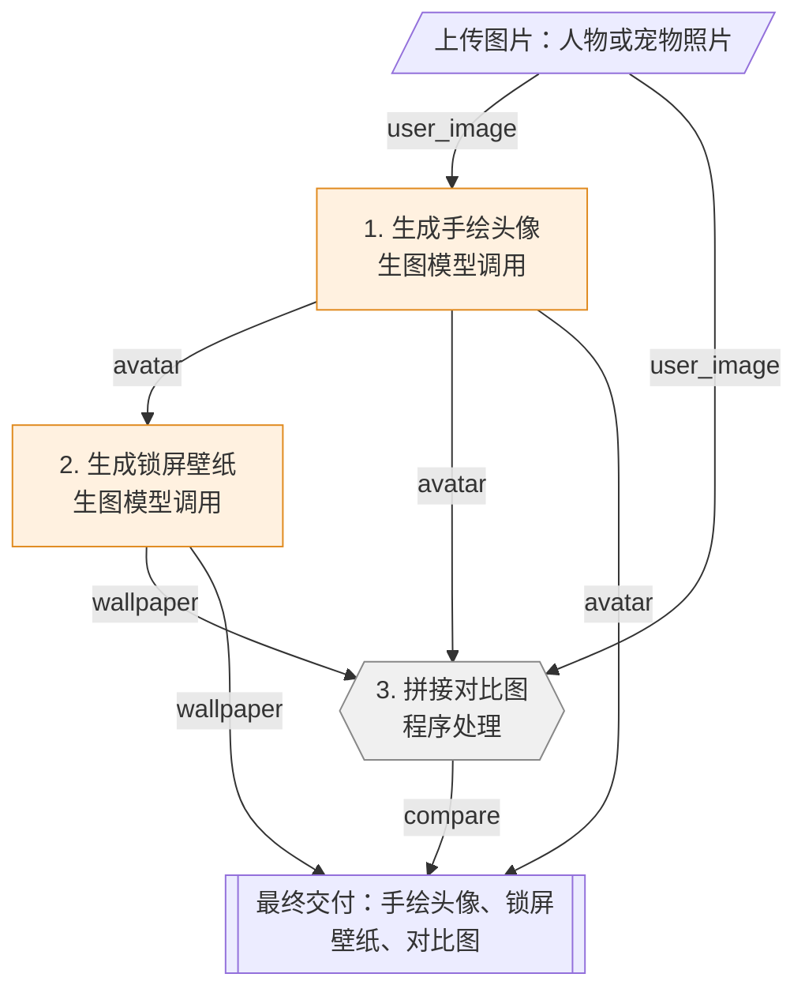

# 玩法：水彩手绘头像三件套（avatar_pack_watercolor）

> 流程类型：`avatar_pack` · 规格定义 v0.4  
> 本文件由 flowkit 根据 flow.json 自动生成。要修改，请改 flow.json 后重新生成，不要直接改本文件。

## 1. 概述

用户上传 1 张人物或宠物照片，生成水彩马克笔手绘头像，再用头像生成手机锁屏壁纸，最后把原图、头像、壁纸拼成一张对比图。

- 出图数量：3 张
- 每次运行调用：文字模型 0 次，生图模型 2 次
- 生图模型：gpt-image-2；文字模型：不指定（须支持看图）

### 参考案例（复刻目标）

来源：虚构示例：水彩马克笔手绘头像定制笔记（示例为虚构参考案例，未附原图；实际使用时把原图放进 reference/ 并填 file）

| 顺序 | 原图 | 这张图是什么 |
|---|---|---|
| 1 | （未附图片） | 第 1 张：三栏对比图，原照片 / 手绘头像 / 锁屏壁纸 |
| 2 | （未附图片） | 第 2 张：手绘头像大图 |
| 3 | （未附图片） | 第 3 张：锁屏壁纸，角色在下半部，上方留空 |

**原标题**

````text
把自拍变成水彩手绘头像，也太可爱了吧
````

**原正文**

````text
用 AI 把照片画成水彩马克笔风头像🎨
顺便出了一张同款锁屏壁纸，一整套换上心情都变好了！
````

**原标签**：#手绘头像 #水彩 #头像 #壁纸

复刻验收用两份输入：`sample_input` 为**还原测试**（尽量用原作内容，结果应接近原作）；`transfer_input` 为**迁移测试**（换成完全不同的内容，风格应保持、画面应跟着内容变）。

## 2. 流程图

蓝色圆角为文字模型调用，橙色方框为生图模型调用，灰色六边形为程序处理；连线上是传递的变量。



## 3. 输入

用户图片 `user_image`：人物或宠物照片，必填，最多 1 张。正脸、光线清楚、主体完整的照片效果最好

## 4. 预置图

无。

## 5. 步骤详情

### 步骤 1：生成手绘头像（`img_avatar`）

| 项目 | 内容 |
|---|---|
| 类型 | 生图模型调用 |
| 页面角色 | `avatar` 头像 |
| 执行方式 | 执行 1 次 |
| 执行条件 | 总是执行 |
| 参考方式 | — |
| 图片尺寸 | 1024x1024 |
| 读取变量 | `user_image` |
| 输出变量 | `avatar` |
| 完成后暂停确认 | 否 |

**提示词设计说明**（这段提示词复刻的是什么）

| 层 | 内容 |
|---|---|
| 风格层（固定） | 水彩加马克笔：马克笔勾轻松轮廓，水彩平涂带晕染和笔触，配色明快，浅色纯净背景 |
| 关系层（固定） | 没有文字，画面完全由用户照片决定：保留让熟人一眼认出的 2～3 个特征并略微夸张，其余简化；只画头肩，居中，占约 70% |
| 变化层（槽位） | {{img:user_image}} 用户照片中的人物或宠物 |
| 不照搬 | 照片的背景、光线和杂物 |
| 提示词来源 | AI 反推 |

**完整提示词**

````text
{{img:user_image}}
【图1】是用户的照片，只参考主体的五官、发型（或毛色花纹）、神态和服装颜色；照片的背景、光线和画质都不要保留。
把【图1】中的主体画成一张手绘头像，1:1。
【风格】水彩加马克笔：马克笔勾出轻松的轮廓线，水彩平涂并留有晕染和笔触，配色明快，浅色纯净背景。
【图文关系】这张图没有文字，画面完全由照片决定：保留让熟人一眼认出的 2～3 个特征并略微夸张，其余细节简化；只画头部和肩部，主体居中，约占画面 70%。
【不要】文字、水印和照片里的背景杂物。
````

**槽位**

| 槽位 | 类型 | 来源 | 填入规则 |
|---|---|---|---|
| `{{img:user_image}}` | 图片 | 用户上传的图片「人物或宠物照片」 | 作为参考图传给模型，此处写为【图N】 |

本步每次调用传入图片：1 张（上限 5）。

**输出与连接规则**

保存生成的图片。

### 步骤 2：生成锁屏壁纸（`img_wallpaper`）

| 项目 | 内容 |
|---|---|
| 类型 | 生图模型调用 |
| 页面角色 | `wallpaper` 壁纸 |
| 执行方式 | 执行 1 次 |
| 执行条件 | 总是执行 |
| 参考方式 | — |
| 图片尺寸 | 1024x1536 |
| 读取变量 | `avatar` |
| 输出变量 | `wallpaper` |
| 完成后暂停确认 | 否 |

**提示词设计说明**（这段提示词复刻的是什么）

| 层 | 内容 |
|---|---|
| 风格层（固定） | 与头像一致的水彩马克笔手绘（通过【图1】参考头像） |
| 关系层（固定） | 画面为锁屏服务：角色在下半部，宽度约 60%；上方 1/3 留干净浅色背景给时间；点缀元素从角色的颜色和神态延伸出来 |
| 变化层（槽位） | {{img:avatar}} 上一步画好的头像 |
| 不照搬 | 文字、时间数字 |
| 提示词来源 | AI 反推 |

**完整提示词**

````text
{{img:avatar}}
【图1】是刚画好的手绘头像，保持它的画风、角色外观和配色。
以【图1】的角色为主角，画一张竖版手机锁屏壁纸。
【风格】与【图1】一致的水彩加马克笔手绘。
【图文关系】画面为锁屏服务：角色放在下半部分，宽度约占画面 60%；上方 1/3 留出干净的浅色天空或背景，给锁屏时间留位置；从角色的颜色和神态延伸出同色系的水彩花草或云朵作为点缀。
【不要】文字、水印和时间数字。
````

**槽位**

| 槽位 | 类型 | 来源 | 填入规则 |
|---|---|---|---|
| `{{img:avatar}}` | 图片 | 步骤「生成手绘头像」的输出 | 作为参考图传给模型，此处写为【图N】 |

本步每次调用传入图片：1 张（上限 5）。

**输出与连接规则**

保存生成的图片。

### 步骤 3：拼接对比图（`op_compare`）

| 项目 | 内容 |
|---|---|
| 类型 | 程序处理 |
| 页面角色 | `compare` 对比图 |
| 执行方式 | 执行 1 次 |
| 执行条件 | 总是执行 |
| 读取变量 | `user_image`、`avatar`、`wallpaper` |
| 输出变量 | `compare` |
| 完成后暂停确认 | 否 |

**输出与连接规则**

把 user_image、avatar、wallpaper 按版式 `row` 拼成一张图，间距 24px，背景 #FFFFFF。

## 6. 变量连接总表

| 变量 | 类型 | 数量 | 由谁产生 | 被谁使用 |
|---|---|---|---|---|
| `user_image` | 图片 | — | 用户上传的图片「人物或宠物照片」 | 生成手绘头像、拼接对比图 |
| `avatar` | 图片 | — | 步骤「生成手绘头像」的输出 | 生成锁屏壁纸、拼接对比图、最终交付 |
| `wallpaper` | 图片 | — | 步骤「生成锁屏壁纸」的输出 | 拼接对比图、最终交付 |
| `compare` | 图片 | — | 步骤「拼接对比图」的输出 | 最终交付 |

## 7. 输出交付

| 顺序 | 内容 | 显示名 | 形式 |
|---|---|---|---|
| 1 | `avatar` | 手绘头像 | 图片，可下载 |
| 2 | `wallpaper` | 锁屏壁纸 | 图片，可下载 |
| 3 | `compare` | 对比图 | 图片，可下载 |

## 8. 通用连接规则

以下规则对所有玩法相同。实现网页或脚本时必须照此执行，不能自行发挥。

**R-1 用户文字拆分**：按换行拆成列表，去掉每行首尾空格，忽略空行。空行不表示分组。

**R-2 文字槽位填入**
- `{{x}}`：文本原样填入；列表按换行拼接全部项；JSON 对象填入其 JSON 文本；空值填空字符串。
- `{{x[i]}}` 第 i 项（从 1 开始）；`{{x.all}}` 按换行拼接；`{{x.inline}}` 用“、”拼接；`{{x.count}}` 项数；`{{x.字段}}` 取 JSON 字段，可多级。
- 循环内：`{{item}}` 当前项（可接 `.字段`）；`{{group[j]}}` 当前组第 j 项；`{{index}}` 当前轮序号，两位数，从 01 开始；`{{total}}` 总轮数；`{{x.current}}` 列表 x 中与当前轮同序号的一项。

**R-3 图片槽位填入**
- 每次调用中，图片按槽位在提示词里出现的先后编号为 图1、图2……，槽位所在位置替换为文字 `【图N】`，图片本身按同样顺序传给模型。
- `{{img?:x}}`：x 有值就传；x 为空时，删除该槽位所在的整行。
- `ref_mode=anchor(n)` 时第 n 轮、`ref_mode=chain` 时第 1 轮：含 `{{img:anchor}}` / `{{img:prev}}` 的整行删除。
- 一次调用的图片总数不超过 5 张。

**R-4 模型调用方式（OpenAI 兼容接口）**
- 文字模型：`POST {Base URL}/chat/completions`，一条 user 消息；content 按提示词顺序由文字段和图片段（data URL）交替组成。
- 生图模型（默认 gpt-image-2）：没有图片时 `POST /images/generations`（JSON：model、prompt、size、n=1）；有图片时 `POST /images/edits`（multipart：model、prompt、size、n=1，以及按顺序排列的多个 `image[]`）。返回 `data[0].b64_json` 或 `data[0].url`。

**R-5 输出解析**
- text：去掉 ``` 代码围栏和首尾空白。
- list：去掉代码围栏；如果是 JSON 字符串数组就直接用；否则按行拆分、去空行、去掉行首编号（如 `1.` `01、` `-` `第3条：`）。
- json：取第一个 `{` 到最后一个 `}` 解析；json_list：取第一个 `[` 到最后一个 `]` 解析。
- 按步骤声明检查数量、字段、倍数。不通过视为输出不合规。

**R-6 失败处理**
- 模型输出不合规：自动重试，最多 2 次；仍失败则停在该步，展示原始输出，允许单步重试。
- 接口报错：停在该步，展示错误，允许单步重试。
- 用户输入不合规（行数、倍数、必填、字数、图片）：提交前拦截，指出具体哪一项，不自动截断。

**R-7 循环与执行顺序**
- 步骤按编号顺序执行；`when` 不满足的步骤跳过，其输出为空。
- `per_item` 每项一轮，`grouped(k)` 按位置每 k 项一轮（第 1～k 项为第 1 组），`whole_list` 与 `once` 只执行 1 次。
- 每轮结果按轮次顺序收集成列表，作为该步输出。
- 参考方式：无或 `fixed` 时各轮可并行；`anchor(n)` 先执行第 n 轮，其余并行；`chain` 逐轮串行。
- 条件互斥的两个步骤可以共用同一个输出变量，后续步骤不必关心走了哪个分支。

**R-8 人工确认**：标记“完成后暂停确认”的步骤执行后暂停，展示结果；用户可修改文字、重新生成本步，或确认继续。修改后的结果要重新通过 R-5 的检查。

**R-9 交付**：按“输出交付”表的顺序展示；图片文件名为 `序号_显示名.png`（列表图片再加两位序号），文字项提供一键复制。

## 9. 校验结果

| 级别 | 编号 | 说明 |
|---|---|---|
| 提醒 | D13 | 参考图 1 只有文字说明，没有图片文件。 |
| 提醒 | D13 | 参考图 2 只有文字说明，没有图片文件。 |
| 提醒 | D13 | 参考图 3 只有文字说明，没有图片文件。 |
