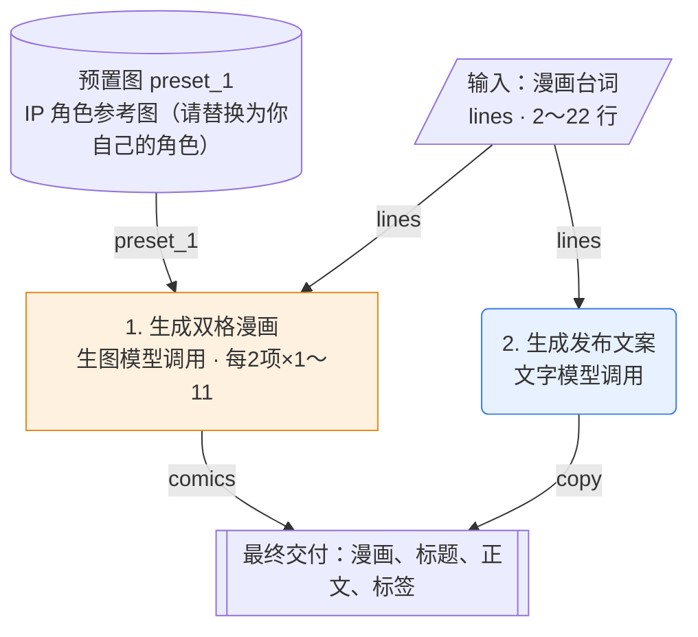

# 玩法：IP 漫画双宫格（ip_comic_pairs）

> 流程类型：`ip_comic` · 规格定义 v0.4  
> 本文件由 flowkit 根据 flow.json 自动生成。要修改，请改 flow.json 后重新生成，不要直接改本文件。

## 1. 概述

用户按两行一组写漫画台词，每组生成一张上下双格竖版漫画，角色固定为预置的 IP 形象；最后生成发布文案。

- 出图数量：1～11 张
- 每次运行调用：文字模型 1 次，生图模型 1～11 次
- 生图模型：gpt-image-2；文字模型：不指定（须支持看图）

### 参考案例（复刻目标）

来源：虚构示例：IP 漫画账号「爆米花团团」的一篇打工日常（示例为虚构参考案例，未附原图；实际使用时把原图放进 reference/ 并填 file）

| 顺序 | 原图 | 这张图是什么 |
|---|---|---|
| 1 | （未附图片） | 第 1 张：上格团团被闹钟吵醒、伸手按闹钟（台词：周一早上闹钟响了）；下格团团缩回被子只露眼睛（台词：再睡五分钟就起） |
| 2 | （未附图片） | 第 2 张：上格团团惊坐起看手机；下格团团面无表情看着全勤奖奖状飞走 |

**原标题**

````text
打工人的周一 be like😂
````

**原正文**

````text
谁懂啊，每个周一都是这样开始的……
团团今天也在努力（赖床）
你们周一几点起？
````

**原标签**：#打工人日常 #原创漫画 #周一综合征 #爆米花团团

复刻验收用两份输入：`sample_input` 为**还原测试**（尽量用原作内容，结果应接近原作）；`transfer_input` 为**迁移测试**（换成完全不同的内容，风格应保持、画面应跟着内容变）。

## 2. 流程图

蓝色圆角为文字模型调用，橙色方框为生图模型调用，灰色六边形为程序处理；连线上是传递的变量。



## 3. 输入

| 变量 | 显示名 | 行数 | 倍数 | 必填 | 单行字数上限 | 逐字保留 | 输入框提示 |
|---|---|---|---|---|---|---|---|
| `lines` | 漫画台词 | 2～22 | 2 | 是 | 30 | 是 | 周一早上闹钟响了 / 再睡五分钟就起 / 睁眼一看已经九点 / 今天也是全勤奖无缘的一天 |

用户图片：不使用。

## 4. 预置图

| 变量 | 文件 | 用途 |
|---|---|---|
| `preset_1` | `presets/ip_reference.png` | IP 角色参考图（请替换为你自己的角色） |

**固定主角**

| 项目 | 内容 |
|---|---|
| 主角类型 | 卡通角色 |
| 保留（每张都一样） | 脸型、五官画法、发型/发饰、配色、服装、标志物、身体比例 |
| 变化（跟着内容走） | 表情、动作、姿势、手里的东西、场景、道具 |

换主角时只换预置图，提示词不用改。

## 5. 步骤详情

### 步骤 1：生成双格漫画（`img_comics`）

| 项目 | 内容 |
|---|---|
| 类型 | 生图模型调用 |
| 页面角色 | `comic` 多格漫画 |
| 执行方式 | 分组循环：`lines` 每 2 项 1 轮，共 1～11 轮 |
| 执行条件 | 总是执行 |
| 参考方式 | — |
| 图片尺寸 | 1024x1536 |
| 读取变量 | `preset_1`、`lines` |
| 输出变量 | `comics` |
| 完成后暂停确认 | 否 |

**提示词设计说明**（这段提示词复刻的是什么）

| 层 | 内容 |
|---|---|
| 风格层（固定） | 日系治愈漫画：圆润黑色描边、平涂浅色、背景只用浅色块；上下两格等高，白色细边分隔；角色外观以预置图为准 |
| 关系层（固定） | 上格铺垫、下格反转：上格镜头稍远，演出第一句的情绪并交代场景；下格推近到主角的脸或手，表情与上格形成反差，演出第二句的笑点。场景和道具从台词推出，每格最多 1 个关键道具；台词在对话气泡里 |
| 变化层（槽位） | {{group[1]}}、{{group[2]}} 两句台词；场景、动作、表情、道具都由台词决定 |
| 不照搬 | 原作里的闹钟、被子、奖状等具体道具；不要照搬预置图里角色的姿势 |
| 提示词来源 | AI 反推 |

**完整提示词**

````text
{{img:preset_1}}
【图1】是本系列漫画的固定主角（卡通角色）。保持【图1】的脸型、五官画法、发型/发饰、配色、服装、标志物和身体比例，画风统一成本页风格。它的表情、动作、姿势和手里的东西按本页台词重新设计，不要照搬【图1】。
画一张竖版 3:4 的上下双格漫画。
【风格】干净的日系治愈漫画：圆润的黑色描边，平涂浅色，背景只用浅色块或几根线表示环境；两格等高，中间用白色细边分隔。
【图文关系】上格是铺垫：主角用表情和动作演出第一句台词的情绪，镜头稍远，交代在哪里、在做什么。下格是反转：同一场景推近到主角的脸或手，表情和上格形成明显反差，把第二句台词的笑点演出来。场景和道具从台词里推出，每格最多 1 个关键道具。台词放在主角旁边的对话气泡里，气泡不遮脸。
上格台词，逐字呈现，不改写、不漏字、不多字：
「{{group[1]}}」
下格台词，逐字呈现，不改写、不漏字、不多字：
「{{group[2]}}」
【不要】两句台词以外的任何文字、水印或页码。
````

**槽位**

| 槽位 | 类型 | 来源 | 填入规则 |
|---|---|---|---|
| `{{img:preset_1}}` | 图片 | 预置图 preset_1（IP 角色参考图（请替换为你自己的角色）） | 作为参考图传给模型，此处写为【图N】 |
| `{{group[1]}}`～`{{group[2]}}` | 文字 | 当前组：lines 中本轮的一组 | 依次取第 1～2 项 |

本步每次调用传入图片：1 张（上限 5）。

**输出与连接规则**

保存生成的图片。 每轮结果按轮次顺序收集成列表 `comics`。

**质量验收**

- 每格台词逐字准确
- 主角与【图1】一致
- 上下两格，比例 3:4

### 步骤 2：生成发布文案（`txt_copy`）

| 项目 | 内容 |
|---|---|
| 类型 | 文字模型调用 |
| 执行方式 | 执行 1 次 |
| 执行条件 | 总是执行 |
| 读取变量 | `lines` |
| 输出变量 | `copy` |
| 完成后暂停确认 | 否 |

**完整提示词**

````text
你是小红书运营。下面是一组 IP 漫画的全部台词（每两行是一张双格漫画）：
{{lines.all}}

请为这组漫画写发布文案：
- title：不超过 20 个字，戳中共鸣；
- body：100～200 字，轻松幽默，结尾引导评论互动；
- tags：5～8 个话题标签，不带 # 号。
只输出一个 JSON 对象，格式：{"title": "", "body": "", "tags": [""]}
````

**槽位**

| 槽位 | 类型 | 来源 | 填入规则 |
|---|---|---|---|
| `{{lines.all}}` | 文字 | 用户输入「漫画台词」 | 全部项按换行拼接 |

本步每次调用传入图片：0 张（上限 5）。

**输出与连接规则**

取第一个 { 到最后一个 } 解析为 JSON 对象。 必须包含字段：`title`、`body`、`tags`。 不合规时自动重试，最多 2 次；仍失败则停止并保留原始输出。

## 6. 变量连接总表

| 变量 | 类型 | 数量 | 由谁产生 | 被谁使用 |
|---|---|---|---|---|
| `lines` | 文字列表 | 2～22 | 用户输入「漫画台词」 | 生成双格漫画、生成发布文案 |
| `preset_1` | 图片 | — | 预置图 preset_1（IP 角色参考图（请替换为你自己的角色）） | 生成双格漫画 |
| `comics` | 图片列表 | 1～11 | 步骤「生成双格漫画」的输出 | 最终交付 |
| `copy` | JSON | — | 步骤「生成发布文案」的输出 | 最终交付 |

## 7. 输出交付

| 顺序 | 内容 | 显示名 | 形式 |
|---|---|---|---|
| 1 | `comics` | 漫画 | 图片，可下载 |
| 2 | `copy.title` | 标题 | 文字，一键复制 |
| 3 | `copy.body` | 正文 | 文字，一键复制 |
| 4 | `copy.tags` | 标签 | 文字，一键复制 |

## 8. 通用连接规则

以下规则对所有玩法相同。实现网页或脚本时必须照此执行，不能自行发挥。

**R-1 用户文字拆分**：按换行拆成列表，去掉每行首尾空格，忽略空行。空行不表示分组。

**R-2 文字槽位填入**
- `{{x}}`：文本原样填入；列表按换行拼接全部项；JSON 对象填入其 JSON 文本；空值填空字符串。
- `{{x[i]}}` 第 i 项（从 1 开始）；`{{x.all}}` 按换行拼接；`{{x.inline}}` 用“、”拼接；`{{x.count}}` 项数；`{{x.字段}}` 取 JSON 字段，可多级。
- 循环内：`{{item}}` 当前项（可接 `.字段`）；`{{group[j]}}` 当前组第 j 项；`{{index}}` 当前轮序号，两位数，从 01 开始；`{{total}}` 总轮数；`{{x.current}}` 列表 x 中与当前轮同序号的一项。

**R-3 图片槽位填入**
- 每次调用中，图片按槽位在提示词里出现的先后编号为 图1、图2……，槽位所在位置替换为文字 `【图N】`，图片本身按同样顺序传给模型。
- `{{img?:x}}`：x 有值就传；x 为空时，删除该槽位所在的整行。
- `ref_mode=anchor(n)` 时第 n 轮、`ref_mode=chain` 时第 1 轮：含 `{{img:anchor}}` / `{{img:prev}}` 的整行删除。
- 一次调用的图片总数不超过 5 张。

**R-4 模型调用方式（OpenAI 兼容接口）**
- 文字模型：`POST {Base URL}/chat/completions`，一条 user 消息；content 按提示词顺序由文字段和图片段（data URL）交替组成。
- 生图模型（默认 gpt-image-2）：没有图片时 `POST /images/generations`（JSON：model、prompt、size、n=1）；有图片时 `POST /images/edits`（multipart：model、prompt、size、n=1，以及按顺序排列的多个 `image[]`）。返回 `data[0].b64_json` 或 `data[0].url`。

**R-5 输出解析**
- text：去掉 ``` 代码围栏和首尾空白。
- list：去掉代码围栏；如果是 JSON 字符串数组就直接用；否则按行拆分、去空行、去掉行首编号（如 `1.` `01、` `-` `第3条：`）。
- json：取第一个 `{` 到最后一个 `}` 解析；json_list：取第一个 `[` 到最后一个 `]` 解析。
- 按步骤声明检查数量、字段、倍数。不通过视为输出不合规。

**R-6 失败处理**
- 模型输出不合规：自动重试，最多 2 次；仍失败则停在该步，展示原始输出，允许单步重试。
- 接口报错：停在该步，展示错误，允许单步重试。
- 用户输入不合规（行数、倍数、必填、字数、图片）：提交前拦截，指出具体哪一项，不自动截断。

**R-7 循环与执行顺序**
- 步骤按编号顺序执行；`when` 不满足的步骤跳过，其输出为空。
- `per_item` 每项一轮，`grouped(k)` 按位置每 k 项一轮（第 1～k 项为第 1 组），`whole_list` 与 `once` 只执行 1 次。
- 每轮结果按轮次顺序收集成列表，作为该步输出。
- 参考方式：无或 `fixed` 时各轮可并行；`anchor(n)` 先执行第 n 轮，其余并行；`chain` 逐轮串行。
- 条件互斥的两个步骤可以共用同一个输出变量，后续步骤不必关心走了哪个分支。

**R-8 人工确认**：标记“完成后暂停确认”的步骤执行后暂停，展示结果；用户可修改文字、重新生成本步，或确认继续。修改后的结果要重新通过 R-5 的检查。

**R-9 交付**：按“输出交付”表的顺序展示；图片文件名为 `序号_显示名.png`（列表图片再加两位序号），文字项提供一键复制。

## 9. 校验结果

| 级别 | 编号 | 说明 |
|---|---|---|
| 提醒 | D13 | 参考图 1 只有文字说明，没有图片文件。 |
| 提醒 | D13 | 参考图 2 只有文字说明，没有图片文件。 |
