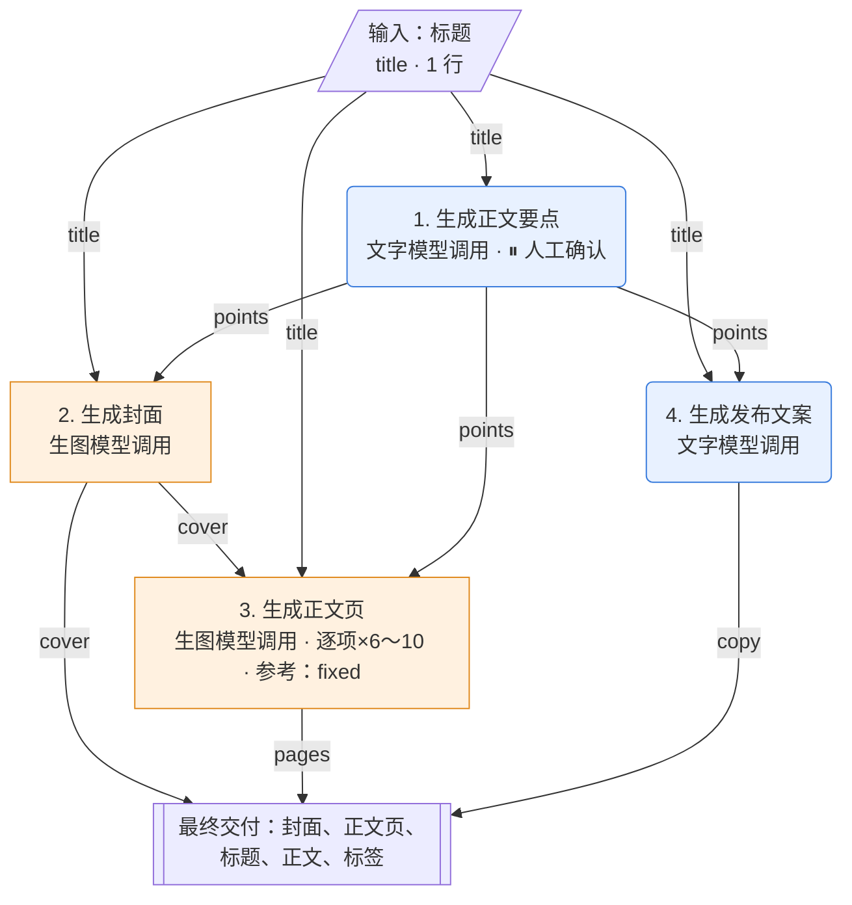

# 玩法：标题生成知识卡片（knowledge_card_title_atlas）

> 流程类型：`knowledge_card` · 规格定义 v0.4  
> 本文件由 flowkit 根据 flow.json 自动生成。要修改，请改 flow.json 后重新生成，不要直接改本文件。

## 1. 概述

用户只输入一个标题，AI 先列出 6～10 条正文要点（可人工修改），再生成 1 张封面和逐条正文页，最后写好小红书标题、正文和标签。

- 出图数量：7～11 张
- 每次运行调用：文字模型 2 次，生图模型 7～11 次
- 生图模型：gpt-image-2；文字模型：不指定（须支持看图）

### 参考案例（复刻目标）

来源：虚构示例：小红书知识博主《打工人必备的 8 个效率神器》（示例为虚构参考案例，未附原图；实际使用时把原图放进 reference/ 并填 file）

| 顺序 | 原图 | 这张图是什么 |
|---|---|---|
| 1 | （未附图片） | 封面：米黄旧纸，大号毛笔手写标题占上半部，四周散落闹钟、笔记本、耳机等小插画 |
| 2 | （未附图片） | 正文页 1：上方小标题「番茄钟：25 分钟专注一件事」，下方画一个番茄形状的计时器 |
| 3 | （未附图片） | 正文页 2：上方小标题「降噪耳机：隔绝开放工位噪音」，下方画一副耳机 |
| 4 | （未附图片） | ……正文页 3～8 版式相同，每页画一个对应的物件 |

**原标题**

````text
打工人必备的 8 个效率神器｜第 5 个真的绝了
````

**原正文**

````text
上班摸鱼不如高效下班！整理了我用了两年的 8 个效率神器👇
每一个都亲测好用，建议先收藏再慢慢看～
你们还有什么宝藏工具？评论区交流！
````

**原标签**：#效率工具 #打工人 #职场干货 #自我提升

复刻验收用两份输入：`sample_input` 为**还原测试**（尽量用原作内容，结果应接近原作）；`transfer_input` 为**迁移测试**（换成完全不同的内容，风格应保持、画面应跟着内容变）。

## 2. 流程图

蓝色圆角为文字模型调用，橙色方框为生图模型调用，灰色六边形为程序处理；连线上是传递的变量。



## 3. 输入

| 变量 | 显示名 | 行数 | 倍数 | 必填 | 单行字数上限 | 逐字保留 | 输入框提示 |
|---|---|---|---|---|---|---|---|
| `title` | 标题 | 1 | — | 是 | 30 | 否 | 打工人必备的 8 个效率神器 |

用户图片：不使用。

## 4. 预置图

无。

## 5. 步骤详情

### 步骤 1：生成正文要点（`txt_points`）

| 项目 | 内容 |
|---|---|
| 类型 | 文字模型调用 |
| 执行方式 | 执行 1 次 |
| 执行条件 | 总是执行 |
| 读取变量 | `title` |
| 输出变量 | `points` |
| 完成后暂停确认 | 是 |

**完整提示词**

````text
你是小红书知识博主。请围绕下面这个标题，写出 6～10 条正文要点，每条要点将来单独做成一张知识卡片。

标题：{{title}}

要求：
1. 每条要点一行，格式为「小标题：一句话解释」，总长不超过 40 个字；
2. 要点之间不重复，按从基础到进阶的顺序排列；
3. 只输出要点本身，不要编号，不要开场白和总结。
````

**槽位**

| 槽位 | 类型 | 来源 | 填入规则 |
|---|---|---|---|
| `{{title}}` | 文字 | 用户输入「标题」 | 全部项按换行拼接 |

本步每次调用传入图片：0 张（上限 5）。

**输出与连接规则**

解析为列表：若是 JSON 字符串数组就直接用；否则按行拆分、去空行、去掉行首编号。 数量要求：6～10。 不合规时自动重试，最多 2 次；仍失败则停止并保留原始输出。

### 步骤 2：生成封面（`img_cover`）

| 项目 | 内容 |
|---|---|
| 类型 | 生图模型调用 |
| 页面角色 | `cover` 封面 |
| 执行方式 | 执行 1 次 |
| 执行条件 | 总是执行 |
| 参考方式 | — |
| 图片尺寸 | 1024x1536 |
| 读取变量 | `title`、`points` |
| 输出变量 | `cover` |
| 完成后暂停确认 | 否 |

**提示词设计说明**（这段提示词复刻的是什么）

| 层 | 内容 |
|---|---|
| 风格层（固定） | 复古手绘图鉴风：米黄做旧纸、黑色墨线、赭石/墨绿/暗红三色、毛笔手写体标题 |
| 关系层（固定） | 文字即画面：标题占上半部约 40%，是第一视觉；从标题里提取 3～5 个关键物件画成小插画，散落在标题四周，每个不超过画面 8% |
| 变化层（槽位） | {{title}} 标题文字；小插画画什么由标题决定；{{points.count}} 条数 |
| 不照搬 | 原作封面上的闹钟、笔记本、耳机等具体物件 |
| 提示词来源 | AI 反推 |

**完整提示词**

````text
设计一套小红书知识卡片的封面，竖版 3:4。
【风格】复古手绘图鉴风：米黄色做旧纸张底纹，边缘略有磨损；黑色墨线手绘，线条有粗细变化；配色只用赭石、墨绿、暗红三色；标题用粗壮的毛笔手写体。
【图文关系】封面以文字为主、插画为辅：标题占画面上半部约 40%，是第一视觉；从标题里提取 3～5 个具体的关键物件，画成小插画，散落在标题四周，每个插画不超过画面的 8%。
标题逐字呈现，不改写、不漏字、不多字：「{{title}}」
底部一行小字：「共 {{points.count}} 条 · 建议收藏」
【不要】水印、二维码，以及标题和底部小字以外的任何文字。
````

**槽位**

| 槽位 | 类型 | 来源 | 填入规则 |
|---|---|---|---|
| `{{title}}` | 文字 | 用户输入「标题」 | 全部项按换行拼接 |
| `{{points.count}}` | 文字 | 步骤「生成正文要点」的输出 | 取项数 |

本步每次调用传入图片：0 张（上限 5）。

**输出与连接规则**

保存生成的图片。

### 步骤 3：生成正文页（`img_pages`）

| 项目 | 内容 |
|---|---|
| 类型 | 生图模型调用 |
| 页面角色 | `detail` 正文页 |
| 执行方式 | 逐项循环：`points` 每项 1 轮，共 6～10 轮 |
| 执行条件 | 总是执行 |
| 参考方式 | 统一参考同一张已生成的图（可并行） |
| 图片尺寸 | 1024x1536 |
| 读取变量 | `cover`、`title`、`points` |
| 输出变量 | `pages` |
| 完成后暂停确认 | 否 |

**提示词设计说明**（这段提示词复刻的是什么）

| 层 | 内容 |
|---|---|
| 风格层（固定） | 与封面完全一致（通过【图1】参考封面） |
| 关系层（固定） | 字面图解：上文下图；上方 40% 是小标题和解释，下方 50% 只画 1 个主体，画的是这条要点里提到的那个具体东西或动作，不看文字也能猜到本页讲什么 |
| 变化层（槽位） | {{item}} 要点文字；插画主体由要点决定；{{index}}/{{total}} 页码 |
| 不照搬 | 原作正文页里的番茄计时器、耳机等；不要复制封面的标题和插画 |
| 提示词来源 | AI 反推 |

**完整提示词**

````text
{{img:cover}}
【图1】是本套卡片的封面，只参考它的纸张底纹、线条、配色和字体，不要复制它的标题和插画。
生成同一套卡片中的一张正文页，竖版 3:4。
【风格】与【图1】完全一致：米黄做旧纸、黑色墨线手绘、赭石/墨绿/暗红配色、毛笔手写体标题。
【图文关系】上文下图：上方约 40% 是文字区，冒号前的小标题放大做本页标题，冒号后的解释做正文；下方约 50% 画 1 幅插画，画的是这条内容里提到的那个具体东西或动作，让人不看文字也能猜到这页讲什么；只画 1 个主体，不画场景全景。
页眉小字：{{title}}　　页码：{{index}}/{{total}}
本页文字逐字呈现，不改写、不漏字、不多字：
「{{item}}」
【不要】水印、二维码，以及页眉、页码和本页文字以外的任何文字。
````

**槽位**

| 槽位 | 类型 | 来源 | 填入规则 |
|---|---|---|---|
| `{{img:cover}}` | 图片 | 步骤「生成封面」的输出 | 作为参考图传给模型，此处写为【图N】 |
| `{{title}}` | 文字 | 用户输入「标题」 | 全部项按换行拼接 |
| `{{index}}` | 文字 | 当前轮序号（01、02…） | 原样填入 |
| `{{total}}` | 文字 | 本步总轮数 | 原样填入 |
| `{{item}}` | 文字 | 当前项：points 的第 {index} 项 | 原样填入 |

本步每次调用传入图片：1 张（上限 5）。

**输出与连接规则**

保存生成的图片。 每轮结果按轮次顺序收集成列表 `pages`。

### 步骤 4：生成发布文案（`txt_copy`）

| 项目 | 内容 |
|---|---|
| 类型 | 文字模型调用 |
| 执行方式 | 执行 1 次 |
| 执行条件 | 总是执行 |
| 读取变量 | `title`、`points` |
| 输出变量 | `copy` |
| 完成后暂停确认 | 否 |

**完整提示词**

````text
你是小红书运营。根据下面的卡片内容，写一篇配图笔记的发布文案。

卡片标题：{{title}}
卡片要点：
{{points.all}}

要求：
- title：不超过 20 个字，可以带 1 个 emoji；
- body：200～400 字，口语化，分段，适当使用 emoji，结尾引导收藏；
- tags：5～8 个话题标签，不带 # 号。
只输出一个 JSON 对象，格式：{"title": "", "body": "", "tags": [""]}
````

**槽位**

| 槽位 | 类型 | 来源 | 填入规则 |
|---|---|---|---|
| `{{title}}` | 文字 | 用户输入「标题」 | 全部项按换行拼接 |
| `{{points.all}}` | 文字 | 步骤「生成正文要点」的输出 | 全部项按换行拼接 |

本步每次调用传入图片：0 张（上限 5）。

**输出与连接规则**

取第一个 { 到最后一个 } 解析为 JSON 对象。 必须包含字段：`title`、`body`、`tags`。 不合规时自动重试，最多 2 次；仍失败则停止并保留原始输出。

## 6. 变量连接总表

| 变量 | 类型 | 数量 | 由谁产生 | 被谁使用 |
|---|---|---|---|---|
| `title` | 文字列表 | 1 | 用户输入「标题」 | 生成正文要点、生成封面、生成正文页、生成发布文案 |
| `points` | 文字列表 | 6～10 | 步骤「生成正文要点」的输出 | 生成封面、生成正文页、生成发布文案 |
| `cover` | 图片 | — | 步骤「生成封面」的输出 | 生成正文页、最终交付 |
| `pages` | 图片列表 | 6～10 | 步骤「生成正文页」的输出 | 最终交付 |
| `copy` | JSON | — | 步骤「生成发布文案」的输出 | 最终交付 |

## 7. 输出交付

| 顺序 | 内容 | 显示名 | 形式 |
|---|---|---|---|
| 1 | `cover` | 封面 | 图片，可下载 |
| 2 | `pages` | 正文页 | 图片，可下载 |
| 3 | `copy.title` | 标题 | 文字，一键复制 |
| 4 | `copy.body` | 正文 | 文字，一键复制 |
| 5 | `copy.tags` | 标签 | 文字，一键复制 |

## 8. 通用连接规则

以下规则对所有玩法相同。实现网页或脚本时必须照此执行，不能自行发挥。

**R-1 用户文字拆分**：按换行拆成列表，去掉每行首尾空格，忽略空行。空行不表示分组。

**R-2 文字槽位填入**
- `{{x}}`：文本原样填入；列表按换行拼接全部项；JSON 对象填入其 JSON 文本；空值填空字符串。
- `{{x[i]}}` 第 i 项（从 1 开始）；`{{x.all}}` 按换行拼接；`{{x.inline}}` 用“、”拼接；`{{x.count}}` 项数；`{{x.字段}}` 取 JSON 字段，可多级。
- 循环内：`{{item}}` 当前项（可接 `.字段`）；`{{group[j]}}` 当前组第 j 项；`{{index}}` 当前轮序号，两位数，从 01 开始；`{{total}}` 总轮数；`{{x.current}}` 列表 x 中与当前轮同序号的一项。

**R-3 图片槽位填入**
- 每次调用中，图片按槽位在提示词里出现的先后编号为 图1、图2……，槽位所在位置替换为文字 `【图N】`，图片本身按同样顺序传给模型。
- `{{img?:x}}`：x 有值就传；x 为空时，删除该槽位所在的整行。
- `ref_mode=anchor(n)` 时第 n 轮、`ref_mode=chain` 时第 1 轮：含 `{{img:anchor}}` / `{{img:prev}}` 的整行删除。
- 一次调用的图片总数不超过 5 张。

**R-4 模型调用方式（OpenAI 兼容接口）**
- 文字模型：`POST {Base URL}/chat/completions`，一条 user 消息；content 按提示词顺序由文字段和图片段（data URL）交替组成。
- 生图模型（默认 gpt-image-2）：没有图片时 `POST /images/generations`（JSON：model、prompt、size、n=1）；有图片时 `POST /images/edits`（multipart：model、prompt、size、n=1，以及按顺序排列的多个 `image[]`）。返回 `data[0].b64_json` 或 `data[0].url`。

**R-5 输出解析**
- text：去掉 ``` 代码围栏和首尾空白。
- list：去掉代码围栏；如果是 JSON 字符串数组就直接用；否则按行拆分、去空行、去掉行首编号（如 `1.` `01、` `-` `第3条：`）。
- json：取第一个 `{` 到最后一个 `}` 解析；json_list：取第一个 `[` 到最后一个 `]` 解析。
- 按步骤声明检查数量、字段、倍数。不通过视为输出不合规。

**R-6 失败处理**
- 模型输出不合规：自动重试，最多 2 次；仍失败则停在该步，展示原始输出，允许单步重试。
- 接口报错：停在该步，展示错误，允许单步重试。
- 用户输入不合规（行数、倍数、必填、字数、图片）：提交前拦截，指出具体哪一项，不自动截断。

**R-7 循环与执行顺序**
- 步骤按编号顺序执行；`when` 不满足的步骤跳过，其输出为空。
- `per_item` 每项一轮，`grouped(k)` 按位置每 k 项一轮（第 1～k 项为第 1 组），`whole_list` 与 `once` 只执行 1 次。
- 每轮结果按轮次顺序收集成列表，作为该步输出。
- 参考方式：无或 `fixed` 时各轮可并行；`anchor(n)` 先执行第 n 轮，其余并行；`chain` 逐轮串行。
- 条件互斥的两个步骤可以共用同一个输出变量，后续步骤不必关心走了哪个分支。

**R-8 人工确认**：标记“完成后暂停确认”的步骤执行后暂停，展示结果；用户可修改文字、重新生成本步，或确认继续。修改后的结果要重新通过 R-5 的检查。

**R-9 交付**：按“输出交付”表的顺序展示；图片文件名为 `序号_显示名.png`（列表图片再加两位序号），文字项提供一键复制。

## 9. 校验结果

| 级别 | 编号 | 说明 |
|---|---|---|
| 提醒 | D13 | 参考图 1 只有文字说明，没有图片文件。 |
| 提醒 | D13 | 参考图 2 只有文字说明，没有图片文件。 |
| 提醒 | D13 | 参考图 3 只有文字说明，没有图片文件。 |
| 提醒 | D13 | 参考图 4 只有文字说明，没有图片文件。 |
