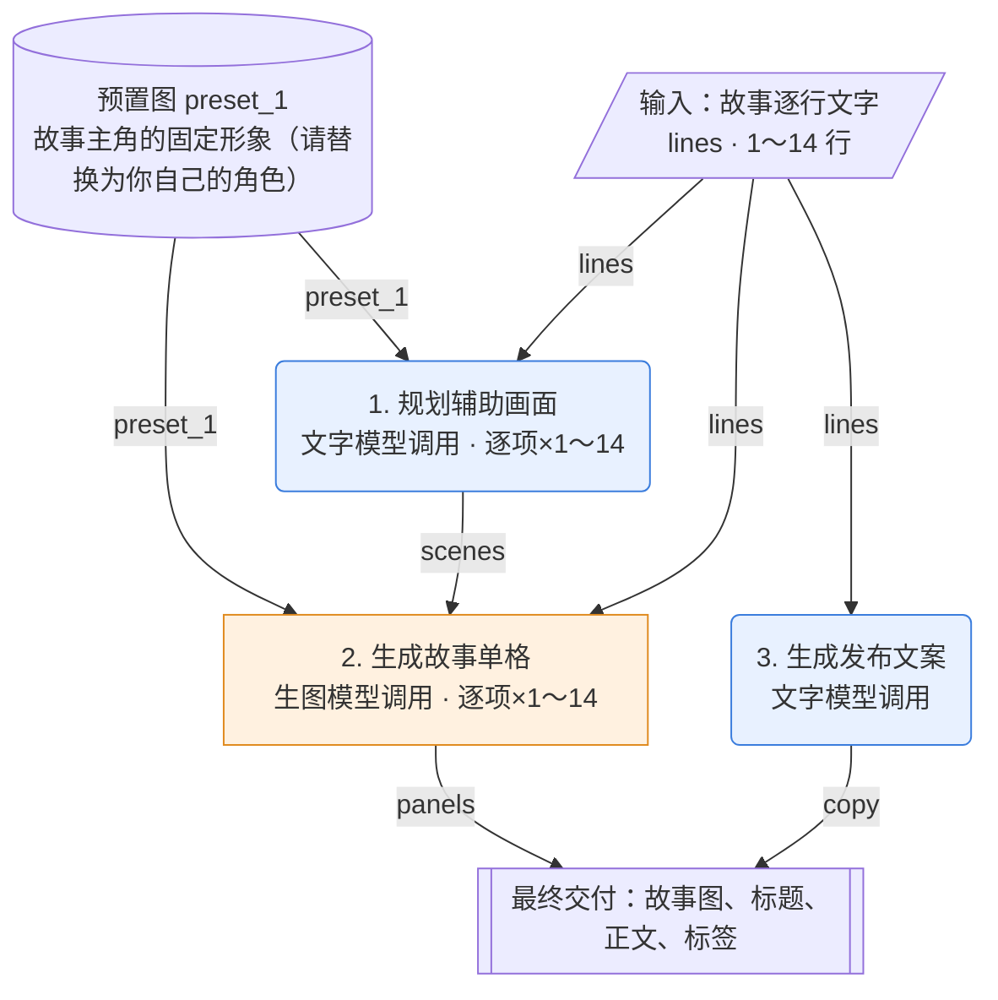

# 玩法：故事 IP 单格图（story_ip_panels）

> 流程类型：`story_ip` · 规格定义 v0.4  
> 本文件由 flowkit 根据 flow.json 自动生成。要修改，请改 flow.json 后重新生成，不要直接改本文件。

## 1. 概述

用户逐行写故事文字，AI 先为每行规划辅助画面（不改文字），再以固定形象为主角逐行出图，最后写发布文案。

- 出图数量：1～14 张
- 每次运行调用：文字模型 2～15 次，生图模型 1～14 次
- 生图模型：gpt-image-2；文字模型：不指定（须支持看图）

### 参考案例（复刻目标）

来源：虚构示例：小和尚故事绘本账号的一篇（示例为虚构参考案例，未附原图；实际使用时把原图放进 reference/ 并填 file）

| 顺序 | 原图 | 这张图是什么 |
|---|---|---|
| 1 | （未附图片） | 第 1 张：小和尚背着小包袱站在山路口回望寺庙，下方写「小和尚第一次下山」 |
| 2 | （未附图片） | 第 2 张：热闹集市一角，小和尚蹲下看地上的小鸟 |
| 3 | （未附图片） | 第 3 张：小和尚把碗里的饭递给小鸟 |

**原标题**

````text
小和尚下山记｜温柔的人运气不会太差
````

**原正文**

````text
今天的小和尚第一次下山🌿
在热闹的集市里，他只看见了那只受伤的小鸟。
愿你也被世界温柔以待。
````

**原标签**：#治愈绘本 #小和尚 #原创故事 #睡前故事

复刻验收用两份输入：`sample_input` 为**还原测试**（尽量用原作内容，结果应接近原作）；`transfer_input` 为**迁移测试**（换成完全不同的内容，风格应保持、画面应跟着内容变）。

## 2. 流程图

蓝色圆角为文字模型调用，橙色方框为生图模型调用，灰色六边形为程序处理；连线上是传递的变量。



## 3. 输入

| 变量 | 显示名 | 行数 | 倍数 | 必填 | 单行字数上限 | 逐字保留 | 输入框提示 |
|---|---|---|---|---|---|---|---|
| `lines` | 故事逐行文字 | 1～14 | — | 是 | 40 | 是 | 小和尚第一次下山 / 他在集市上看见一只受伤的小鸟 / 他把自己的斋饭分给了小鸟 |

用户图片：不使用。

## 4. 预置图

| 变量 | 文件 | 用途 |
|---|---|---|
| `preset_1` | `presets/ip_reference.png` | 故事主角的固定形象（请替换为你自己的角色） |

**固定主角**

| 项目 | 内容 |
|---|---|
| 主角类型 | 卡通角色 |
| 保留（每张都一样） | 脸型、五官画法、发型/发饰、配色、服装、标志物、身体比例 |
| 变化（跟着内容走） | 表情、动作、姿势、手里的东西、场景、道具 |

换主角时只换预置图，提示词不用改。

## 5. 步骤详情

### 步骤 1：规划辅助画面（`txt_scenes`）

| 项目 | 内容 |
|---|---|
| 类型 | 文字模型调用 |
| 执行方式 | 逐项循环：`lines` 每项 1 轮，共 1～14 轮 |
| 执行条件 | 总是执行 |
| 读取变量 | `preset_1`、`lines` |
| 输出变量 | `scenes` |
| 完成后暂停确认 | 否 |

**完整提示词**

````text
{{img:preset_1}}
【图1】是故事主角。下面是故事的第 {{index}}/{{total}} 页页面文字：
「{{item}}」

请为这一页规划画面。注意：页面文字会原样印在图上，你只负责画面，不要改写或复述文字。
只输出一个 JSON 对象，字段：
- helper_scene：一句话描述画面（主角在做什么、在哪里、什么氛围）；
- purpose：这个画面帮助读者理解什么；
- key_objects：画面中必须出现的 2～4 个关键物体（字符串数组）；
- avoid：画面中要避免的元素（一句话）。
````

**槽位**

| 槽位 | 类型 | 来源 | 填入规则 |
|---|---|---|---|
| `{{img:preset_1}}` | 图片 | 预置图 preset_1（故事主角的固定形象（请替换为你自己的角色）） | 作为参考图传给模型，此处写为【图N】 |
| `{{index}}` | 文字 | 当前轮序号（01、02…） | 原样填入 |
| `{{total}}` | 文字 | 本步总轮数 | 原样填入 |
| `{{item}}` | 文字 | 当前项：lines 的第 {index} 项 | 原样填入 |

本步每次调用传入图片：1 张（上限 5）。

**输出与连接规则**

取第一个 { 到最后一个 } 解析为 JSON 对象。 必须包含字段：`helper_scene`、`purpose`、`key_objects`、`avoid`。 每轮结果按轮次顺序收集成列表 `scenes`。 不合规时自动重试，最多 2 次；仍失败则停止并保留原始输出。

### 步骤 2：生成故事单格（`img_panels`）

| 项目 | 内容 |
|---|---|
| 类型 | 生图模型调用 |
| 页面角色 | `panel` 单格图 |
| 执行方式 | 逐项循环：`lines` 每项 1 轮，共 1～14 轮 |
| 执行条件 | 总是执行 |
| 参考方式 | — |
| 图片尺寸 | 1024x1536 |
| 读取变量 | `preset_1`、`scenes`、`lines` |
| 输出变量 | `panels` |
| 完成后暂停确认 | 否 |

**提示词设计说明**（这段提示词复刻的是什么）

| 层 | 内容 |
|---|---|
| 风格层（固定） | 温暖的水彩绘本风：纸张纹理、柔和晕染、暖黄主色调、细而少的线条；主角外观以预置图为准 |
| 关系层（固定） | 场景叙事：画面是本页文字所描述那一刻的一个镜头，主角在做文字里的动作，表情对应文字里的情绪；具体画面由上一步的画面规划决定。画面占上方约 80%，下方约 20% 留白写字 |
| 变化层（槽位） | {{item}} 本页文字；{{scenes.current.*}} 画面规划 |
| 不照搬 | 原作里的寺庙、集市、小鸟、饭碗等具体场景和道具 |
| 提示词来源 | AI 反推 |

**完整提示词**

````text
{{img:preset_1}}
【图1】是故事的固定主角（卡通角色）。保持【图1】的脸型、五官画法、发型/发饰、配色、服装、标志物和身体比例，画风统一成本页风格。它的表情、动作、姿势和手里的东西按本页内容重新设计，不要照搬【图1】。
生成一张竖版 3:4 的故事插画。
【风格】温暖的水彩绘本风：纸张纹理，柔和晕染，暖黄为主色调，线条细而少。
【图文关系】画面是本页文字所描述那一刻的一个镜头：主角正在做文字里说的动作，表情对应文字里的情绪。画面占上方约 80%，下方约 20% 留白写字。具体画面按下面的规划：
画面：{{scenes.current.helper_scene}}
必须出现：{{scenes.current.key_objects.inline}}
避免：{{scenes.current.avoid}}
本页文字写在下方留白处，逐字呈现，不改写、不漏字、不多字：「{{item}}」
【不要】页码、水印或其他文字。
````

**槽位**

| 槽位 | 类型 | 来源 | 填入规则 |
|---|---|---|---|
| `{{img:preset_1}}` | 图片 | 预置图 preset_1（故事主角的固定形象（请替换为你自己的角色）） | 作为参考图传给模型，此处写为【图N】 |
| `{{scenes.current.helper_scene}}` | 文字 | 步骤「规划辅助画面」的输出 | 取与当前轮同序号的一项，取字段 helper_scene |
| `{{scenes.current.key_objects.inline}}` | 文字 | 步骤「规划辅助画面」的输出 | 取与当前轮同序号的一项，取字段 key_objects，全部项用“、”拼接 |
| `{{scenes.current.avoid}}` | 文字 | 步骤「规划辅助画面」的输出 | 取与当前轮同序号的一项，取字段 avoid |
| `{{item}}` | 文字 | 当前项：lines 的第 {index} 项 | 原样填入 |

本步每次调用传入图片：1 张（上限 5）。

**输出与连接规则**

保存生成的图片。 每轮结果按轮次顺序收集成列表 `panels`。

**质量验收**

- 页面文字逐字准确
- 主角与【图1】一致

### 步骤 3：生成发布文案（`txt_copy`）

| 项目 | 内容 |
|---|---|
| 类型 | 文字模型调用 |
| 执行方式 | 执行 1 次 |
| 执行条件 | 总是执行 |
| 读取变量 | `lines` |
| 输出变量 | `copy` |
| 完成后暂停确认 | 否 |

**完整提示词**

````text
你是小红书运营。下面是一个绘本小故事的全部页面文字：
{{lines.all}}

请写发布文案：title 不超过 20 个字；body 100～200 字，温暖治愈，结尾引导评论；tags 5～8 个，不带 # 号。
只输出一个 JSON 对象，格式：{"title": "", "body": "", "tags": [""]}
````

**槽位**

| 槽位 | 类型 | 来源 | 填入规则 |
|---|---|---|---|
| `{{lines.all}}` | 文字 | 用户输入「故事逐行文字」 | 全部项按换行拼接 |

本步每次调用传入图片：0 张（上限 5）。

**输出与连接规则**

取第一个 { 到最后一个 } 解析为 JSON 对象。 必须包含字段：`title`、`body`、`tags`。 不合规时自动重试，最多 2 次；仍失败则停止并保留原始输出。

## 6. 变量连接总表

| 变量 | 类型 | 数量 | 由谁产生 | 被谁使用 |
|---|---|---|---|---|
| `lines` | 文字列表 | 1～14 | 用户输入「故事逐行文字」 | 规划辅助画面、生成故事单格、生成发布文案 |
| `preset_1` | 图片 | — | 预置图 preset_1（故事主角的固定形象（请替换为你自己的角色）） | 规划辅助画面、生成故事单格 |
| `scenes` | JSON 列表 | 1～14 | 步骤「规划辅助画面」的输出 | 生成故事单格 |
| `panels` | 图片列表 | 1～14 | 步骤「生成故事单格」的输出 | 最终交付 |
| `copy` | JSON | — | 步骤「生成发布文案」的输出 | 最终交付 |

## 7. 输出交付

| 顺序 | 内容 | 显示名 | 形式 |
|---|---|---|---|
| 1 | `panels` | 故事图 | 图片，可下载 |
| 2 | `copy.title` | 标题 | 文字，一键复制 |
| 3 | `copy.body` | 正文 | 文字，一键复制 |
| 4 | `copy.tags` | 标签 | 文字，一键复制 |

## 8. 通用连接规则

以下规则对所有玩法相同。实现网页或脚本时必须照此执行，不能自行发挥。

**R-1 用户文字拆分**：按换行拆成列表，去掉每行首尾空格，忽略空行。空行不表示分组。

**R-2 文字槽位填入**
- `{{x}}`：文本原样填入；列表按换行拼接全部项；JSON 对象填入其 JSON 文本；空值填空字符串。
- `{{x[i]}}` 第 i 项（从 1 开始）；`{{x.all}}` 按换行拼接；`{{x.inline}}` 用“、”拼接；`{{x.count}}` 项数；`{{x.字段}}` 取 JSON 字段，可多级。
- 循环内：`{{item}}` 当前项（可接 `.字段`）；`{{group[j]}}` 当前组第 j 项；`{{index}}` 当前轮序号，两位数，从 01 开始；`{{total}}` 总轮数；`{{x.current}}` 列表 x 中与当前轮同序号的一项。

**R-3 图片槽位填入**
- 每次调用中，图片按槽位在提示词里出现的先后编号为 图1、图2……，槽位所在位置替换为文字 `【图N】`，图片本身按同样顺序传给模型。
- `{{img?:x}}`：x 有值就传；x 为空时，删除该槽位所在的整行。
- `ref_mode=anchor(n)` 时第 n 轮、`ref_mode=chain` 时第 1 轮：含 `{{img:anchor}}` / `{{img:prev}}` 的整行删除。
- 一次调用的图片总数不超过 5 张。

**R-4 模型调用方式（OpenAI 兼容接口）**
- 文字模型：`POST {Base URL}/chat/completions`，一条 user 消息；content 按提示词顺序由文字段和图片段（data URL）交替组成。
- 生图模型（默认 gpt-image-2）：没有图片时 `POST /images/generations`（JSON：model、prompt、size、n=1）；有图片时 `POST /images/edits`（multipart：model、prompt、size、n=1，以及按顺序排列的多个 `image[]`）。返回 `data[0].b64_json` 或 `data[0].url`。

**R-5 输出解析**
- text：去掉 ``` 代码围栏和首尾空白。
- list：去掉代码围栏；如果是 JSON 字符串数组就直接用；否则按行拆分、去空行、去掉行首编号（如 `1.` `01、` `-` `第3条：`）。
- json：取第一个 `{` 到最后一个 `}` 解析；json_list：取第一个 `[` 到最后一个 `]` 解析。
- 按步骤声明检查数量、字段、倍数。不通过视为输出不合规。

**R-6 失败处理**
- 模型输出不合规：自动重试，最多 2 次；仍失败则停在该步，展示原始输出，允许单步重试。
- 接口报错：停在该步，展示错误，允许单步重试。
- 用户输入不合规（行数、倍数、必填、字数、图片）：提交前拦截，指出具体哪一项，不自动截断。

**R-7 循环与执行顺序**
- 步骤按编号顺序执行；`when` 不满足的步骤跳过，其输出为空。
- `per_item` 每项一轮，`grouped(k)` 按位置每 k 项一轮（第 1～k 项为第 1 组），`whole_list` 与 `once` 只执行 1 次。
- 每轮结果按轮次顺序收集成列表，作为该步输出。
- 参考方式：无或 `fixed` 时各轮可并行；`anchor(n)` 先执行第 n 轮，其余并行；`chain` 逐轮串行。
- 条件互斥的两个步骤可以共用同一个输出变量，后续步骤不必关心走了哪个分支。

**R-8 人工确认**：标记“完成后暂停确认”的步骤执行后暂停，展示结果；用户可修改文字、重新生成本步，或确认继续。修改后的结果要重新通过 R-5 的检查。

**R-9 交付**：按“输出交付”表的顺序展示；图片文件名为 `序号_显示名.png`（列表图片再加两位序号），文字项提供一键复制。

## 9. 校验结果

| 级别 | 编号 | 说明 |
|---|---|---|
| 提醒 | D13 | 参考图 1 只有文字说明，没有图片文件。 |
| 提醒 | D13 | 参考图 2 只有文字说明，没有图片文件。 |
| 提醒 | D13 | 参考图 3 只有文字说明，没有图片文件。 |
