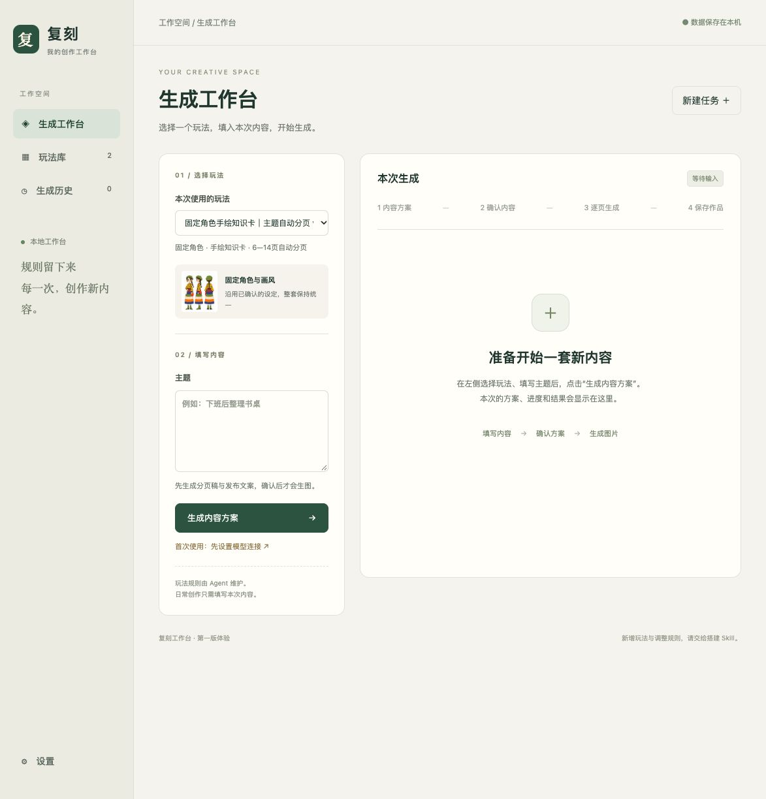

# 复刻工作台 · 界面设计规范

设计基线：2026-10-11 用户认可的四板块工作台。以随包静态代码与截图为复现依据；真实模型质量另行验收。
适用：搭建工作台、增加玩法、维护页面，以及更换模型、Agent 或前端技术时保持界面一致。

## 1. 如何使用这份规范

搭建前必须阅读本文件。优先复用随技能提供的 HTML、CSS 和组件结构，不根据“简洁、现代、好看”等形容词重新自由设计。新增玩法主要替换输入、内容和执行流程，沿用共同界面。

- 技能中的实现基线：`assets/base/static/index.html`、`assets/base/static/style.css`、`assets/base/static/app.js`。
- 生成出的工作台实现：`static/index.html`、`static/style.css`、`static/app.js`。
- 视觉参考：`assets/design-reference.jpg`。另附assets/design-library.jpg与assets/design-detail.jpg。它们是当前工作台的真实截图，截图内案例不是新任务生成结果。
- 本文规定结构、尺寸、色彩和行为；CSS提供完整细节；截图帮助比较整体观感。发现三者冲突时记录具体差异，不自行替换设计风格。明确的用户新要求优先，修改后同步文档、底座、实例和必要截图。



## 2. 视觉方向与页面结构

浅暖灰背景、近白色内容卡片、低饱和深绿色操作色。整体安静、清楚，有充足留白；作品图片是页面中最鲜明的内容。避免增加大面积渐变、玻璃效果、霓虹色、厚重阴影、大型装饰插画或仪表盘统计。

桌面结构如下，不能随意交换左右主次：

```text
左侧导航       │ 顶部：当前位置                          本机状态
生成工作台     │ 选择玩法 / 输入内容    │ 本次方案、确认与生成结果
玩法库         │ 玩法卡片 → 详情：完整流程 / 提示词 / 效果示例
生成历史       │ 用户任务列表 → 独立任务详情
设置（底部）   │ 模型连接；为后续设置保留结构
```

四个一级入口名称固定。玩法库放可复用模板与样张；生成历史仅放用户提交的任务。首页空状态不展示历史案例，不默认加载最近作品。切换历史不清空正在填写的主题，查看历史详情不覆盖当前任务。

## 2.1 玩法详情与数据

详情有返回、玩法名、简介、使用按钮、输入/产物/固定素材概览和三个页签。完整流程按执行顺序展示用户动作、模型步骤、程序校验与确认点；提示词只读、可展开和复制，保留全文；效果示例标明真实来源及验证范围、可放大下载。示例不计入生成历史。

玩法说明来自版本内的 `workbench.json`。早期玩法使用 `ui-profiles` 的兼容默认值。页面不得按玩法名称或ID硬编码流程文案。功能执行由受测试的适配器负责，展示数据不能代替执行逻辑。提示词标题和数量来自flow.steps；每个流程提示词入口以prompt_step引用真实步骤ID。

## 3. 颜色标准

优先使用已有CSS变量，不随模型偏好重新配色。

| 用途 | CSS变量或组件 | 颜色 |
|---|---|---|
| 页面背景 | `--bg` | `#f6f5f0` |
| 卡片和表单底色 | `--paper` | `#fffefa` |
| 主文字 | `--ink` | `#243e36` |
| 次要说明 | `--muted` | `#78827b` |
| 分隔线和卡片描边 | `--line` | `#e4e7df` |
| 主按钮、品牌底色 | `--green` | `#315d49` |
| 浅绿色背景、确认区 | `--soft` | `#eaf0e8` |
| 预留暖金点缀 | `--gold` | `#bb9361`，不大面积使用 |
| 侧栏背景 / 边界 | `.sidebar` | `#eeeee6` / `#e0e3d8` |
| 选中导航背景 / 文字 | `.nav.active` | `#dfe7dc` / `#254d36` |
| 主按钮悬停 | `.primary:hover` | `#244b39` |
| 输入边框 | 表单控件 | `#dce1d6` |
| 历史案例说明背景 / 文字 | `.provenance` | `#f7f3e6` / `#887d5a` |
| 错误背景 / 文字 | `.job-error` | `#fbeee9` / `#9e5641` |
| 顶部操作成功提示背景 | `#notice` | `#e5efdf` |

状态必须同时用文字表达，不能只靠颜色。浅色小字只用于辅助说明；不要将其扩大用于关键操作或正文。当前基线未宣称通过完整无障碍对比度审计，后续可专门改善并同步记录。

## 4. 字体与文字层级

字体栈必须保留：

```css
font-family: -apple-system, BlinkMacSystemFont,
             "PingFang SC", "Microsoft YaHei", sans-serif;
```

正文基础 `14px / 1.65`，表单和按钮继承字体。Mac使用系统苹方等回退，Windows使用微软雅黑等回退。无在线字体依赖。不同操作系统的字形和中间字重可能不同，因此追求同一布局和层级，不能保证每个像素完全相同。

| 元素 | 字号与规则 |
|---|---|
| 页面主标题 | 31px，字重620，字距-0.8px，外边距7px 0 8px |
| 一般二级 / 三级标题 | 18px / 15px |
| 创作区顶部标题 | 16px |
| 欢迎区标题 | 22px，字距-0.4px |
| 页面说明 / 主按钮 | 13px |
| 输入标签 / 正文方案 / 发布稿 | 12px |
| 主题输入内容 | 14px |
| 品牌字 | 23px，字重650，字距2px |
| 辅助标签和说明 | 10—11px；不用于大段阅读 |
| 分区小标签 | 10px，字重600，字距1.7px |
| 顶部英文眉题 | 10px，字距2.2px，仅用于已有的少量装饰标签 |

品牌方标和侧栏短句使用系统 `serif`，其余不混入装饰字体。中文文案保持简短具体；不增加面向新手的代码、模型协议字段或大段技术解释。

## 5. 桌面尺寸与留白

以下为视口宽度1150px以上、1500px以下的默认值，单位均为CSS像素。

| 区域 | 标准 |
|---|---|
| 侧栏 | 固定宽205，内边距33上下/20左右；主壳左边距205 |
| 顶栏 | 高70，左右内边距38，底部1px细线 |
| 主内容 | 最大宽1510，居中，内边距32上/38左右/16下 |
| 页面标题区 | 横向排列，间距20，下边距29 |
| 创作双栏 | 左285，右`minmax(0,1fr)`，栏间距23，顶部对齐 |
| 左表单卡片 | 内边距24，`position:sticky; top:24px` |
| 右创作卡片 | 内边距24上下/26左右，最小高度650 |
| 主卡片 | 圆角14，1px边框，无大阴影 |
| 控件 | 按钮圆角8；输入圆角7、内边距10 |
| 主按钮 | 内边距11上下/18左右；表单主按钮满宽 |
| 主题文本框 | 最小高125，允许纵向调整 |
| 角色提示 | 图56×63、`object-fit:contain`；图文间距11 |
| 流程条 | 上下内边距23、底部分隔线；四个步骤顺序固定 |
| 图片列表 | 3列等宽，间距15；图片卡圆角8 |
| 玩法库 | 桌面2列卡片；每卡最多3张样张预览；≤1150单列 |
| 玩法详情 | 内边距26，圆角14；页签下划线深绿；流程编号圆点35 |
| 提示词 | 只读折叠卡，等宽12px/1.9；换行且最大高560，内部滚动 |
| 生成历史 | 3列等宽，间距18 |
| 模型设置 | 文字/生图两栏等宽，间距22，各卡内边距28 |

优先沿用CSS中的间距，不将所有元素随意压缩为同一个8px或16px。页面纵向滚动；不要为左右卡片同时添加互相竞争的滚动条。只有长提示词明细单独限制高度并滚动。

## 6. 组件和状态

- **空状态**：生成首页只显示填写主题与确认生成的引导。玩法库无样张时显示“暂无效果示例”；历史为空时显示开始生成入口。禁止用占位图冒充真实样张。
- **内容方案**：逐页折叠卡片，显示两位序号、标题、封面/正文/总结；第一页默认展开。分页内容和发布文案分开。
- **确认区**：浅绿色背景，明确图片数量和按钮“确认内容，生成整套图片”。执行提示词在只读折叠区域查看，不能改成输入框。
- **运行中**：显示当前步骤/页数、加载标记及停止入口；重复生成按钮禁用。错误用可读说明和恢复入口表示，不让用户解释技术堆栈。
- **结果**：图片容器3:4，图片使用`object-fit:contain`完整呈现，不能裁掉文字。实际作品原始比例保持不变。页码、标题、下载和重画在图片下方。
- **重画版本**：保留旧版本，可展开查看下载。重画沿用玩法，不增设“这次修改提示词”控件。
- **发布文案**：独立区块，标题、正文、标签清楚分开；复制控件靠近对应内容，正文保留换行。
- **放大预览**：原生dialog，最大90vw/96vh；图片最大85vw/82vh；遮罩`#15251dd9`；有关闭和下载入口。
- **按钮状态**：普通按钮悬停浅绿；主按钮悬停深绿；禁用透明度0.5。保留键盘焦点，轮廓偏移4px，不删除浏览器焦点提示。
- **动画**：仅必要的0.15秒颜色变化及1秒旋转加载标记；尊重`prefers-reduced-motion`，不增加背景或卡片入场动画。

## 7. 响应式规则

断点按视口宽度计算，媒体查询按现有CSS顺序叠加，较窄规则覆盖较宽规则。

| 宽度 | 变化 |
|---|---|
| ≥1500 | 表单列305；输入列与主区沿用CSS；不增加首页案例 |
| ≤1150 | 侧栏170；主区内边距25上下/24左右；表单列250、双栏间距16；输入卡内边距19、结果区20；主标题26；结果图2列；确认区纵向排布 |
| ≤800 | 侧栏改顶部横向导航；取消左侧占位；主内容单列；主标题24；输入卡取消sticky；主题框最小高95；隐藏侧栏短句和角色辅助卡；记录与设置改为1列；结果图片沿用2列 |

窄屏不隐藏输入、确认、下载等核心操作。不得用固定宽度造成横向滚动。已有390px检查通过；每次明显修改布局后仍需重查，不能以旧检查代替新页面验证。

## 8. 哪些可以变化

新增玩法可以替换名称、主题输入、规定的图片输入、角色素材、案例、步骤内容和产物。特殊步骤可增加必要组件，但应沿用颜色、字体、容器、按钮和留白规则。

未经用户要求，不更改导航位置、主次列关系、整体配色、字体栈、主要圆角、关键操作路径；不要自动换成深色模式、另一套组件库默认主题或商业后台模板。代码技术栈变化不是重新设计界面的理由。

## 9. 更换模型或Agent后的验收

1. 先复用底座，再实现功能差异；不要只读取文字描述后凭记忆重画。
2. 用实际浏览器在相同尺寸下对照参考截图：导航宽度、输入列占比、标题层级、卡片留白、颜色、图片完整性和主要按钮位置。
3. 检查首页、内容确认、生成中、失败、结果、历史及模型设置状态。参考图包括首页、玩法库和详情；确认、运行、失败及结果以对应组件与功能测试为依据，不假称已有全部状态的视觉截图。
4. 检查长中文标题、多个玩法、无历史案例和窄屏；关键内容不能被裁切或挤出屏幕。
5. 用户确认设计调整后，同步修改本文件、底座CSS/HTML、已有实例及视觉参考；文件随新工作台一起交付。

这份规范用于减少视觉漂移。跨模型复现仍需检查实际页面，不能仅凭“已读DESIGN.md”宣称效果一致。
